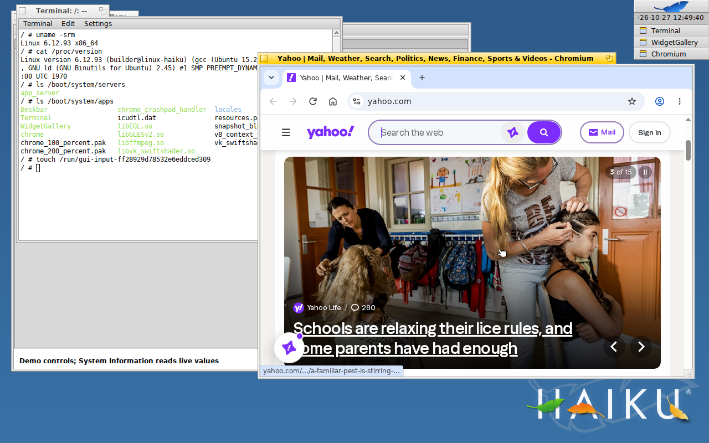
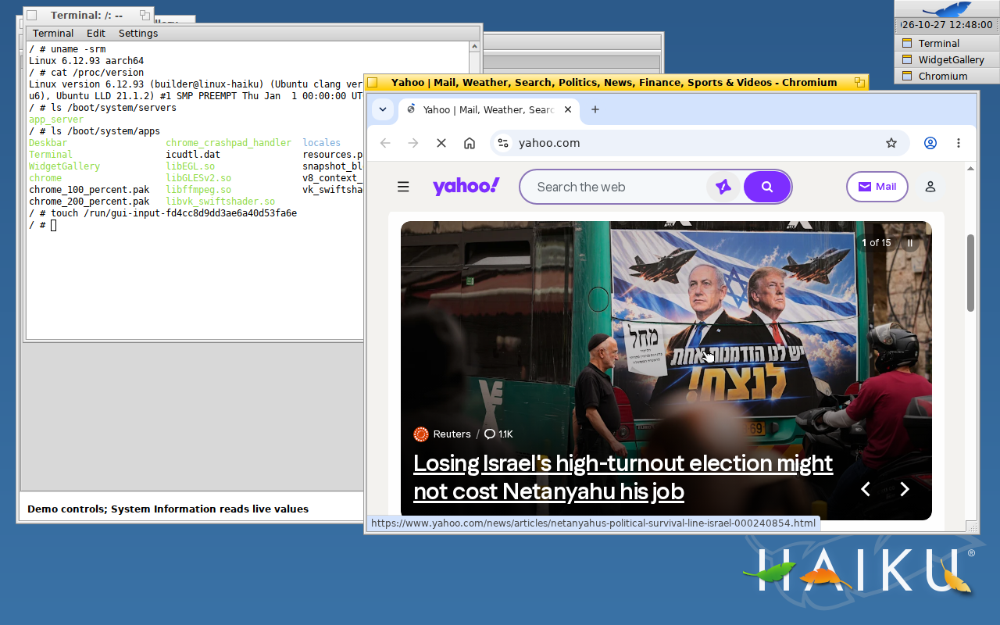
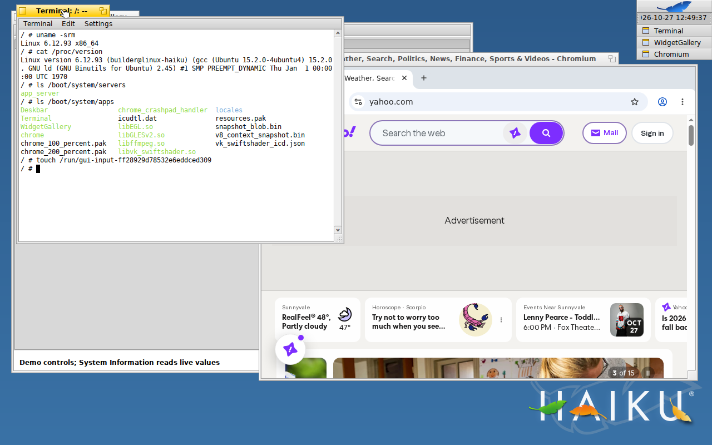
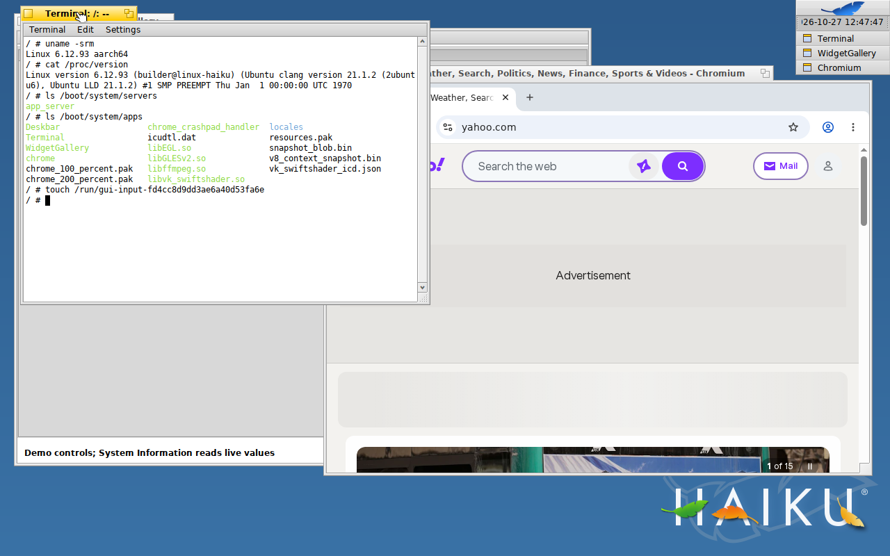
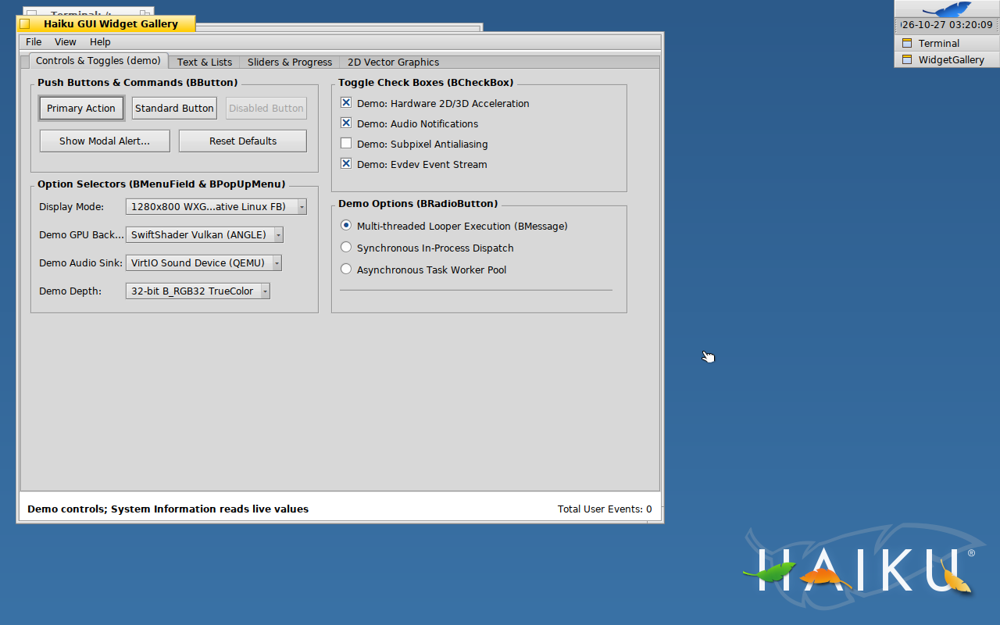
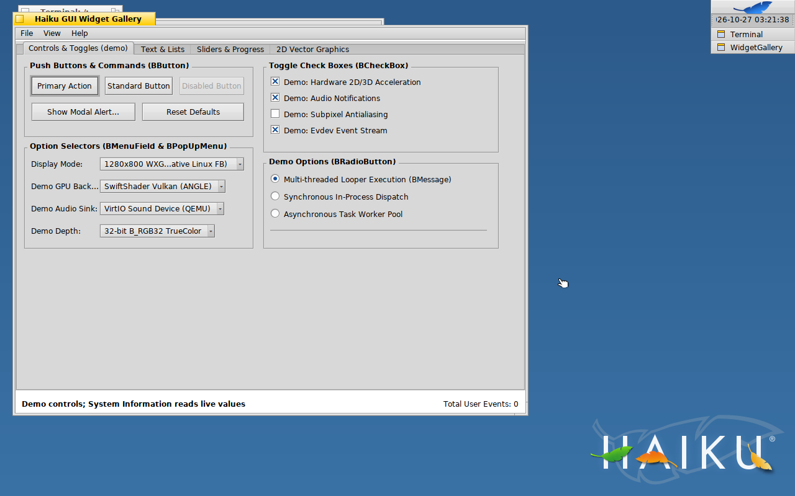
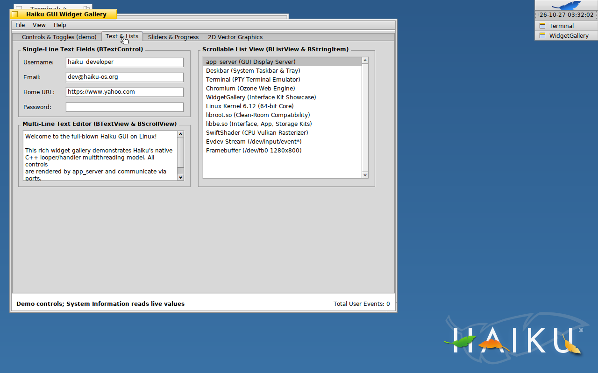
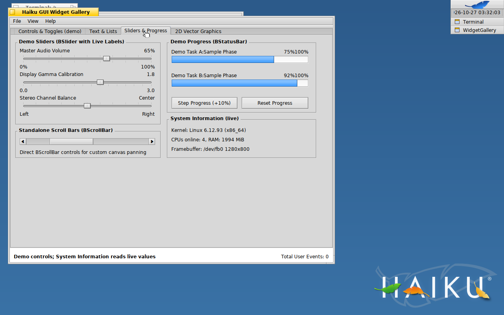
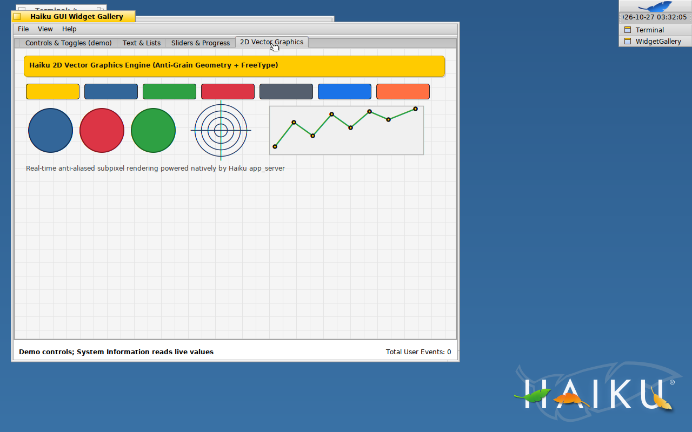

<!-- SPDX-License-Identifier: MIT -->
# 64-bit Linux + Haiku GUI + Chromium (`linux_haiku_chromium`)

[](LICENSE)
[](#supported-targets)
[](MODULE.bazel)

A Bazel-built embedded Linux system that boots a **64-bit Linux 6.12 kernel**
directly into the **upstream Haiku window server (`app_server`) and Haiku GUI
kits (`libbe.so`)** — no X11, no Wayland — and runs **pre-built 64-bit
Chromium inside native Haiku windows** through a custom Ozone platform
(`--ozone-platform=haiku`). Chromium starts on **https://www.yahoo.com**.

Bazel builds the Linux kernel, BusyBox and Haiku userland for **x86_64** and
**ARM64**. Runtime libraries, fonts and certificates are copied from the host;
ARM64 graphics libraries are built from pinned releases. Chromium uses the
packaged binaries rebuilt from a fresh pinned Chromium checkout with the
project patch and GN arguments. Build records for
[x86_64](docs/validation/chromium-build-x86_64.json) and
[ARM64](docs/validation/chromium-build-arm64.json) link the source, dependencies,
patch, configuration, toolchain and packaged bytes. Runtime checks are
recorded in [the validation report](docs/VALIDATION.md).

---

## Screenshots

These screenshots are fresh captures of locally built images from the QEMU
framebuffer. Desktop and Chromium captures use the automated verifiers;
gallery captures use `scripts/capture_gallery.py` on separately running QEMU
desktops.
Logs and artifact hashes are in [docs/VALIDATION.md](docs/VALIDATION.md).

### Tier 3: Chromium showing www.yahoo.com

| x86_64 (QEMU + KVM) | ARM64 (QEMU `virt`, Cortex-A72, emulated) |
| --- | --- |
|  |  |

The verifier first brings the Haiku Terminal to the front and types
`uname -srm`, `cat /proc/version`, `ls /boot/system/servers` and
`ls /boot/system/apps` (proving a Linux kernel with Haiku's `app_server`,
Deskbar, Terminal, WidgetGallery and `chrome` in `/boot/system`), then
re-activates Chromium and scrolls the Yahoo page with the mouse wheel:

| x86_64 Terminal proof | ARM64 Terminal proof |
| --- | --- |
|  |  |

### Tier 2: Haiku GUI desktop (no Chromium)

| x86_64 | ARM64 |
| --- | --- |
|  |  |

### Haiku Widget Gallery

A demo Haiku application ([`userland/widget_gallery`](userland/widget_gallery/widget_gallery.cpp))
exercising the Interface Kit: `BMenuBar`, `BTabView`, `BButton`, `BCheckBox`,
`BRadioButton`, `BMenuField`/`BPopUpMenu`, `BTextControl` (incl. password),
`BTextView`/`BScrollView`, `BListView`, `BSlider`, `BScrollBar`,
`BStatusBar`, `BBox`, `BSeparatorView` and a custom `BView` drawing canvas.

| Controls | Text & lists | Sliders & progress | 2D drawing |
| --- | --- | --- | --- |
|  |  |  |  |

The four tabs above are from x86_64. Controls and progress bars are demonstrations; they do not change system hardware, audio or build settings. The "System Information (live)" box is
read at runtime (`uname()`, `sysconf()`, `/sys/class/graphics/fb0`); here is
the same tab on ARM64:


To refresh the gallery captures and their boot evidence after rebuilding:

```bash
python3 scripts/run_all_variants.py --tiers 2
python3 - <<'PY'
import json
import subprocess
with open("runtime/desktop-vms.json") as stream:
    for vm in json.load(stream):
        if vm["tier"] == 2:
            subprocess.run(["python3", "scripts/capture_gallery.py",
                            "--socket", vm["qmp_socket"], "--arch", vm["arch"],
                            "--record-evidence"], check=True)
PY
```

This opens two Tier 2 windows. Without `--tiers 2`, the launcher opens all six
variants. Inspect the resulting tab images; the capture tool records hashes
and live guest status but does not perform visual review.

After all six desktop guests reach their boot milestones, record their live
QMP status, GTK window mapping, current boot-input hashes and serial logs:

```bash
python3 scripts/run_all_variants.py --record-validation
```

---

## Supported targets

| | x86_64 | ARM64 |
| --- | --- | --- |
| Kernel | `//kernel:bzImage` | `//kernel:Image` |
| Haiku userland | host GCC | `aarch64-linux-gnu` GCC cross toolchain ([`bazel/toolchains`](bazel/toolchains/BUILD.bazel)) |
| Chromium | [`prebuilt/x86_64`](userland/chromium/prebuilt/x86_64/) | [`prebuilt/arm64`](userland/chromium/prebuilt/arm64/) |
| Tested on | QEMU + KVM, `-vga std` | QEMU `virt` + `virtio-gpu-pci` (TCG emulation) |

> [!NOTE]
> The ARM64 kernel configuration also enables Raspberry Pi 4B drivers
> (BCM2835/BCM2711, `DRM_VC4`), but this repository does not build a Pi SD-card
> image (firmware, device tree, `config.txt`) and has **not been tested on Pi 4B
> hardware**. ARM64 has only been verified in QEMU.

---

## Quick start

Requirements (Debian/Ubuntu host): Git LFS, Bazel 9, `qemu-system-x86` and
`qemu-system-arm`, `gcc`/`g++`, `g++-aarch64-linux-gnu`, `python3`, `curl`,
DejaVu fonts (`/usr/share/fonts/truetype/dejavu`), `ca-certificates`, and a
Linux kernel source tree (`LINUX_SRC`, see [`bazel/repositories.bzl`](bazel/repositories.bzl)).
Kernel builds also need `make`, `flex`, `bison`, `libelf-dev`, `libssl-dev`,
Clang, LLVM and LLD. The ARM64 cross compiler must include C++ support.
The LLVM tools must be available without version suffixes on `PATH`, including
`clang`, `ld.lld`, `llvm-ar`, `llvm-nm`, `llvm-readelf` and `llvm-objcopy`.
For a versioned installation, add its `bin` directory to `PATH` first
(for example, `/usr/lib/llvm-21/bin`).

Before building, retrieve the prebuilt binaries and select a kernel source:

```bash
git lfs pull
export LINUX_SRC="$PWD/.cache/sources/linux-6.12.93"
# Extract the official Linux 6.12.93 archive to that directory first.
```

The verified archive SHA-256 is
`492648a87c0b69c5ac7f43be64792b9000e3439550d4e82e4a14710c49094fa3`.
See [kernel.org](https://www.kernel.org/) for official source downloads.

The output directory configured in [`.bazelrc`](.bazelrc) retains completed
builds across host reboots.

```bash
# Build all six variants, then open six QEMU windows on the current display
bazel build //kernel:bzImage //kernel:Image \
  //minimal_rootfs:image //minimal_rootfs:image_arm64 \
  //rootfs:image //rootfs:image_arm64 \
  //chromium_rootfs:image //chromium_rootfs:image_arm64
python3 scripts/run_all_variants.py

# x86_64 desktop with Chromium on your screen (QEMU + KVM, GTK window)
bazel run //:run_chromium

# ARM64 desktop with Chromium on your screen (emulated: slower)
bazel run //:run_chromium_arm64

# Haiku desktop without Chromium
bazel run //:run          # x86_64
bazel run //:run_arm64    # ARM64
```

## Build from source (no Chromium checkout needed)

```bash
bazel build //kernel:bzImage //chromium_rootfs:image          # x86_64
bazel build //kernel:Image   //chromium_rootfs:image_arm64    # ARM64
```

- The Haiku userland for ARM64 is cross-compiled through a Bazel platform
  transition ([`bazel/arm64.bzl`](bazel/arm64.bzl), [`userland/arm64`](userland/arm64/BUILD.bazel)),
  so no extra flags are needed.
- ARM64 builds zlib, libpng, FreeType and Expat from pinned release tarballs
  ([`third_party/`](third_party)); x86_64 uses the host's shared libraries.
- Haiku sources are fetched at a pinned commit (`MODULE.bazel`).

## Automated verification

```bash
bazel run //minimal_rootfs:verify        # Tier 1 x86_64: libroot test suites
bazel run //minimal_rootfs:verify_arm64  # Tier 1 ARM64
bazel run //rootfs:verify                # Tier 2 x86_64: Haiku desktop
bazel run //rootfs:verify_arm64          # Tier 2 ARM64
bazel run //chromium_rootfs:verify       # Tier 3 x86_64: Chromium must load www.yahoo.com
bazel run //chromium_rootfs:verify_arm64 # Tier 3 ARM64
```

The GUI verifiers type a random-token file-creation command into Terminal
through QMP input and check the resulting file independently from the serial
shell. Required GUI processes must remain alive during the run. Each verifier
records the hashes of the kernel and initramfs it boots; GUI captures also
record screenshot hashes. The validation recorder rejects stale evidence.

Tier 3 additionally requires Chromium's window title to become the Yahoo page title
(logged by `libbe.so` as `[Chromium/OzoneHaiku] Window title: …`) **and** the
page area of the captured framebuffer contains rendered content (not a blank
page). After retaining that screenshot, it opens a fresh local HTTP test page
and requires callbacks for actual browser key, click, wheel and scrolling
events. These are integration smoke tests, not coverage of every Haiku or
Chromium API. Measured results are in [docs/VALIDATION.md](docs/VALIDATION.md).

## Chromium: pre-built binaries and patch

- Pre-built: [`userland/chromium/prebuilt/x86_64`](userland/chromium/prebuilt/x86_64/),
  [`userland/chromium/prebuilt/arm64`](userland/chromium/prebuilt/arm64/) —
  Chromium 158.0.8107.0 (revision `3bb54dbfa29e`).
- Patch: [`userland/chromium/patches/0001-chromium-ozone-haiku-linux.patch`](userland/chromium/patches/0001-chromium-ozone-haiku-linux.patch)
  (adds `ui/ozone/platform/haiku` and makes a GLib/NSS/D-Bus-free Linux build
  work).
- GN args: [`userland/chromium/patches/args/`](userland/chromium/patches/args/).
- How to rebuild: [`userland/chromium/patches/README.md`](userland/chromium/patches/README.md).

## Writing Haiku GUI applications

The Haiku API headers come from the pinned Haiku checkout (`@haiku//:headers`);
link against `libbe.so` and `libroot.so` from this tree. Use
[`userland/widget_gallery`](userland/widget_gallery) as a template:

```python
cc_binary(
    name = "my_app",
    srcs = ["my_app.cpp", "//userland:haiku_compat.h"],
    copts = [
        "-std=c++20", "-D_GNU_SOURCE",
        "-include", "config/types.h",
        "-include", "userland/haiku_compat.h",
    ],
    deps = [
        "//userland/haiku_libbe:haiku_libbe_so",
        "//userland/haiku_libroot",
        "@haiku//:headers",
    ],
)
```

Add the binary to a rootfs rule (see [`rootfs/BUILD.bazel`](rootfs/BUILD.bazel))
and, for ARM64, add an `arm64_files` wrapper in
[`userland/arm64/BUILD.bazel`](userland/arm64/BUILD.bazel).

---

## Repository layout

```text
MODULE.bazel, BUILD.bazel     Bazel module (Haiku, BusyBox, zlib, libpng, FreeType, Expat) and run targets
bazel/                        repository rules, ARM64 platform + cross toolchain, arm64 transition
kernel/                       x86_64 / arm64 defconfigs and kernel build script
third_party/                  BUILD files for zlib, libpng, FreeType, Expat (ARM64)
userland/
  init/                       PID 1 (mounts, network, app_server readiness wait, app launch)
  busybox/                    BusyBox build (x86_64 + aarch64)
  haiku_libroot/              clean-room Haiku kernel API on Linux (MIT)
  haiku_libbe/                upstream Haiku kits + Linux glue, Chromium C ABI, BMessageRunner
  haiku_app_server/           upstream app_server + Linux framebuffer / evdev backends
  haiku_agg/, haiku_apps/     AGG, Deskbar, Terminal
  widget_gallery/             Interface Kit demo app
  arm64/                      ARM64 (cross-compiled) aliases of the above
  chromium/                   prebuilt Chromium (x86_64, arm64), patch, GN args, Ozone sources
minimal_rootfs/, rootfs/, chromium_rootfs/   Tier 1/2/3 images and verifiers
scripts/                      rootfs builder, QEMU verifiers, desktop launcher
docs/                         ARCHITECTURE.md, VALIDATION.md, screenshots/
```

More detail: [docs/ARCHITECTURE.md](docs/ARCHITECTURE.md).

## License

Original project code is MIT. Imported source keeps its upstream copyright notices. Upstream components keep their own licenses (Haiku:
MIT/OpenTracker; Chromium: BSD-3-Clause and bundled third-party licenses;
Linux and BusyBox: GPL-2.0-only; glibc/GCC runtime: LGPL/GPL with runtime
exception). See [LICENSE](LICENSE), [THIRD_PARTY_NOTICES.md](THIRD_PARTY_NOTICES.md)
and [REUSE.toml](REUSE.toml).
