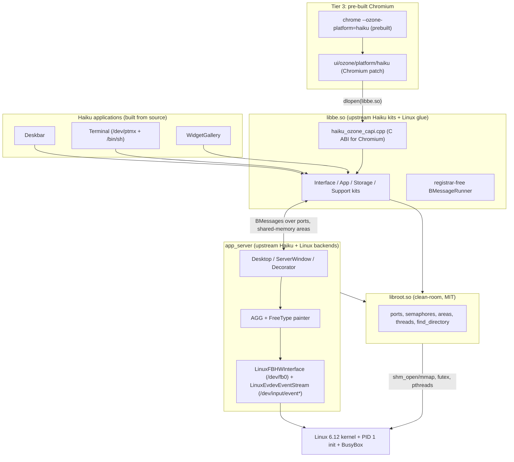

<!-- SPDX-License-Identifier: MIT -->
# Architecture: 64-bit Linux + Haiku GUI + Chromium

## 1. Overview

`linux_haiku_chromium` boots a 64-bit Linux 6.12 kernel straight into the
upstream **Haiku** window server (`app_server`), Haiku's GUI kits (`libbe.so`)
and Haiku applications (Deskbar, Terminal, a widget-gallery demo) — no X11 and
no Wayland — and runs **pre-built 64-bit Chromium** inside native Haiku
windows through a custom Ozone platform (`--ozone-platform=haiku`).

Both Chromium packages were rebuilt from a fresh pinned checkout with the
project patch. Their per-architecture source and binary hashes are recorded in
[`docs/validation`](validation); Bazel packages these separately built outputs.

Two architectures are built from the same sources:

| | x86_64 | ARM64 (aarch64) |
| --- | --- | --- |
| Kernel | `//kernel:bzImage` | `//kernel:Image` |
| Haiku userland | host C++ toolchain | `aarch64-linux-gnu` GCC cross toolchain (`//bazel/toolchains`), selected via a Bazel platform transition (`//userland/arm64`) |
| Chromium | `userland/chromium/prebuilt/x86_64` | `userland/chromium/prebuilt/arm64` |
| Verified on | QEMU `x86_64` + KVM, `-vga std` (Bochs DRM, 1280x800) | QEMU `virt` / `cortex-a72` (TCG emulation), `virtio-gpu-pci` (1280x800) |

> [!NOTE]
> The ARM64 kernel config also enables Raspberry Pi 4B drivers (`ARCH_BCM2835`,
> `DRM_VC4`, `MMC_BCM2835`), but this repository does **not** produce a Pi
> boot image (firmware, DTB, `config.txt`) and has **not** been tested on real
> Pi 4B hardware. All ARM64 results in this repository come from QEMU `virt`.

## 2. Rootfs tiers

| Tier | Package | Contents | Verifier |
| --- | --- | --- | --- |
| 1 | `//minimal_rootfs:image`, `:image_arm64` | init, BusyBox, `libroot.so`, `haiku_libroot_test` (6 suites: system_info, areas, ports, semaphores, threads, find_directory) | `:verify`, `:verify_arm64` |
| 2 | `//rootfs:image`, `:image_arm64` | + `app_server`, `libbe.so`, Deskbar, Terminal, WidgetGallery, DejaVu fonts | `:verify`, `:verify_arm64` |
| 3 | `//chromium_rootfs:image`, `:image_arm64` | Tier 2 + rebuilt Chromium, replaceable FFmpeg, CA bundle, glibc name-service libraries | `:verify`, `:verify_arm64` |

All images are gzip-compressed `newc` CPIO initramfs archives written by
[`scripts/build_rootfs.py`](../scripts/build_rootfs.py), which fails the build
if any listed input is missing.

### Boot sequence (`userland/init/init.c`)

1. Mount `/proc`, `/sys`, `/dev` (devtmpfs), `/dev/pts`, `/dev/shm`, `/tmp`,
   `/run`; set `vm.overcommit_memory=1`, `vm.max_map_count=262144`.
2. Configure `eth0` statically for QEMU user networking (10.0.2.15/24,
   gateway 10.0.2.2, DNS 10.0.2.3).
3. Read `haiku.mode=` from the kernel command line (`tier1`, `gui`,
   `chromium`).
4. GUI modes: start `app_server` and **wait until it writes
   `/run/app_server.ready`** (it does so once its server port and Desktop
   exist). The current measured runs and logs are recorded in
   [VALIDATION.md](VALIDATION.md).
5. Start Deskbar (respawned if it exits), Terminal, WidgetGallery, and in
   `chromium` mode `chrome … https://www.yahoo.com`.
6. Run `/bin/sh` on the serial console and reap children.

## 3. Haiku on Linux

- **`libroot.so`** ([`userland/haiku_libroot`](../userland/haiku_libroot)) is a
  clean-room implementation of the Haiku kernel API used by the kits:
  ports and semaphores live in a shared registry created with `shm_open()` +
  `mmap()` and use Linux futexes for blocking; areas are shared mappings;
  threads are pthreads; `find_directory()` maps to the `/boot/system`
  hierarchy in the initramfs.
  System memory comes from Linux `sysinfo()` with its reported memory unit
  and page size. CPU activity comes from `/proc/stat`, excluding idle, I/O
  wait and hypervisor steal time; frequency comes from
  CPUFreq sysfs and is zero (unknown) when unavailable. Team lookup reads
  `/proc/<pid>/status` and rejects processes that no longer exist. Image and
  area counts and team start times are currently unimplemented and remain
  zero. This adapter implements a subset of Haiku APIs; it is not a complete
  Haiku kernel. Some other compatibility entry points still contain stubs.
  Root-volume device IDs and capacity come from Linux `stat()` and `statvfs()`;
  unbounded ramfs capacity can legitimately be reported as zero. Volume
  enumeration currently exposes only the root filesystem. Read/write locks
  exclude writers and readers, support recursive writers, and park contenders
  with Linux futexes. Initialization-once routines publish their results before
  releasing other threads. Tier 1 includes contention checks for both.
  Node monitoring, filesystem renaming, date-string parsing, cross-team area
  ownership transfer, image enumeration, debugger attachment, add-on unloading
  and priority changes are unsupported and return errors. Large IPC messages
  that require area transfer therefore fail instead of claiming a transfer
  occurred. Basic shared-area cloning is implemented separately.
- **`libbe.so`** ([`userland/haiku_libbe`](../userland/haiku_libbe)) compiles
  upstream Haiku's Support, Storage, App, Interface and selected Shared kit
  sources (pinned Haiku commit in `MODULE.bazel`) with local replacements for
  `Application.cpp`, `Looper.cpp`, `AppMisc.cpp` and `MessageRunner.cpp`
  (there is no registrar; `RUN_WITHOUT_REGISTRAR`). The local
  `BMessageRunner` delivers messages from an in-process timer thread, which is
  what makes `BWindow::SetPulseRate()` / `Pulse()` work (e.g. the Deskbar
  clock).
- **`app_server`** ([`userland/haiku_app_server`](../userland/haiku_app_server))
  is upstream Haiku's server with two Linux backends:
  `LinuxFBHWInterface` (renders into `/dev/fb0`) and `LinuxEvdevEventStream`
  (reads `/dev/input/event*` for keyboard, absolute tablet/mouse and wheel).
- On ARM64, FreeType, libpng, zlib and Expat are built from pinned upstream
  release tarballs ([`third_party/`](../third_party)); on x86_64 the host's
  shared libraries are used.

## 4. Chromium integration

See [`userland/chromium/README.md`](../userland/chromium/README.md) and
[`userland/chromium/patches/README.md`](../userland/chromium/patches/README.md).
The Chromium patch adds `ui/ozone/platform/haiku`, which
`dlopen()`s `libbe.so` and drives Haiku windows through the `haiku_ozone_*`
C ABI. Frames are rendered in software (Skia raster, or ANGLE/SwiftShader with
EGL read-back) and copied into a `BBitmap` that `app_server` draws inside a
yellow-tabbed `BWindow`. Input travels the other way through an `eventfd`
watched by Chromium's UI message pump.
Keyboard shortcuts use the unmodified Haiku key code while text insertion
uses the UTF-8 payload. Tooltip windows avoid focus so they preserve keyboard
input in their owner. The QEMU browser verifier exercises that focus behavior
and requires DOM callbacks for key, click, wheel and actual scrolling events.

## 5. Licensing

| Component | License | How it is included |
| --- | --- | --- |
| Project code (libroot, Linux backends, init, build rules, C ABI, docs) | MIT | source |
| Haiku kits, `app_server`, Deskbar, Terminal | MIT / OpenTracker | built from pinned upstream source |
| AGG, FreeType, libpng, zlib, Expat | AGG / FTL / libpng / zlib / MIT | built from source (ARM64) or host libraries (x86_64) |
| Chromium, ANGLE, SwiftShader | BSD-3-Clause / Apache-2.0 (+ bundled third-party licenses) | binaries rebuilt from pinned source with the project patch |
| FFmpeg | LGPL-2.1 and permissive per-file terms | replaceable shared library; corresponding source snapshot bundled |
| glibc, libstdc++, libgcc_s | LGPL-2.1+ / GPL-3.0 with runtime exception | unmodified host / cross-toolchain copies |
| Linux kernel, BusyBox | GPL-2.0-only | separate binaries built from source |

Details: [`THIRD_PARTY_NOTICES.md`](../THIRD_PARTY_NOTICES.md).
