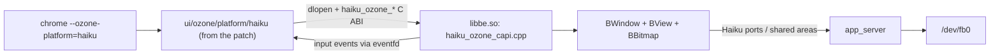

<!-- SPDX-License-Identifier: MIT -->
# `userland/chromium/` — pre-built Chromium for the Haiku GUI

| Path | Contents |
| --- | --- |
| [`prebuilt/x86_64/`](prebuilt/x86_64/) | Stripped Chromium 158.0.8107.0 for x86_64 (`chrome`, `chrome_crashpad_handler`, ANGLE `libEGL.so`/`libGLESv2.so`, SwiftShader `libvk_swiftshader.so`, replaceable FFmpeg `libffmpeg.so`, ICU data, V8 snapshots, `.pak` resources, `en-US` locale). |
| [`prebuilt/arm64/`](prebuilt/arm64/) | The same 14 files rebuilt for ARM64 (aarch64) with its GN arguments. |
| [`patches/`](patches/) | The Chromium source patch, GN args, and rebuild instructions ([`patches/README.md`](patches/README.md)). |
| [`ozone_haiku/`](ozone_haiku/) | Read-only copy of the `ui/ozone/platform/haiku/` sources contained in the patch. |
| [`welcome.html`](welcome.html) | Local fallback page packaged at `/boot/system/data/welcome.html`. |

Chromium is **not** compiled by this repository's Bazel build. The rootfs rules
in [`//chromium_rootfs`](../../chromium_rootfs/BUILD.bazel) copy these files to
`/boot/system/apps/` in the image.

Both packages were rebuilt from a fresh pinned Chromium checkout. The
[x86_64 build record](../../docs/validation/chromium-build-x86_64.json) and
[ARM64 build record](../../docs/validation/chromium-build-arm64.json) record
the source, dependencies, patch, GN arguments, toolchain and output hashes.
See [local validation](../../docs/VALIDATION.md) for runtime evidence.

## How Chromium talks to Haiku

- [`userland/haiku_libbe/haiku_ozone_capi.cpp`](../haiku_libbe/haiku_ozone_capi.cpp)
  (built from source in this repo) implements the C ABI: it starts a
  `BApplication`, creates one `BWindow` per Chromium window, converts Haiku
  mouse/wheel/keyboard messages into a queue signalled through an `eventfd`, and
  blits Chromium's BGRA frames into a `BBitmap`. It also logs
  `[Chromium/OzoneHaiku] Window title: …` to the serial console; the automated
  verifiers use this to detect that `www.yahoo.com` finished loading.
- Chromium runs with `--no-sandbox --no-zygote --disable-gpu --in-process-gpu`
  (software compositing; see [`userland/init/init.c`](../init/init.c) for the
  full command line). TLS certificates are validated with Chromium's built-in
  root store (`chrome_root_store_only = true`).
